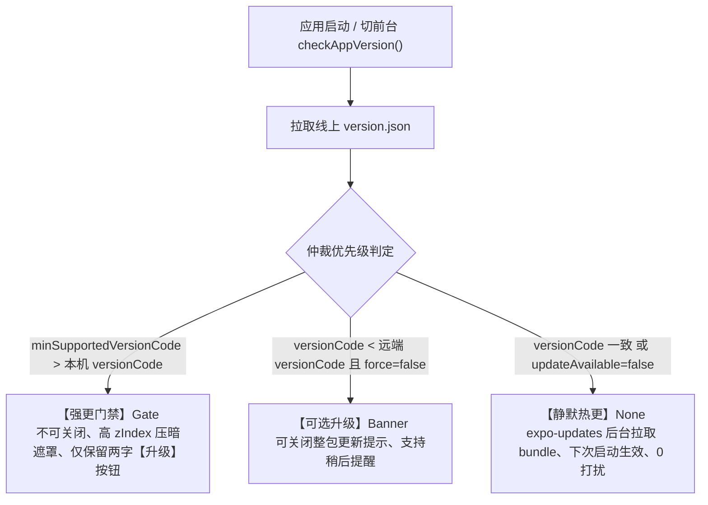

# App OTA 与版本升级运行协议 (OTA & Version Runtime Protocol)

> **修订标准**: 对标 CMMI 3 配置管理与不可变生产投产 (CM/RSKM/PMC)  
> **服务工单**: [COOA-271](/COOA/issues/COOA-271) `[G7·运营] 运营手册 + App OTA 协议 + expo-updates 集成 (强更/热更)`  
> **关联代码**: `clients/expo/App.tsx`, `clients/expo/src/updatePolicy.ts`, `tests/ota-runtime/update-policy.test.ts`

---

## 1. 协议核心架构与版本决策状态机

为了杜绝“静默热更被用户点叉取消”、“强更门禁可被绕过”以及“整包升级与纯 JS 热更打架”的典型发版事故，平台确立三级版本仲裁状态机：



---

## 2. 三大升级呈现模式 (Update Presentations)

| 呈现模式 (`presentation`) | 触发条件 | 界面表现 | 交互约束 | 适用场景 |
| :--- | :--- | :--- | :--- | :--- |
| **`gate` (强更门禁)** | `minSupportedVersionCode > local.versionCode` 或 `forceUpdate=true` | 全屏压暗遮罩 (`rgba(8,9,10,0.96)`)、居中卡片、`ForceUpdateGate` | **不可关闭、不可穿透**、无稍后按钮，仅保留两字【升级】 | 原生断代、数据模型破坏性变更、底层安全补丁 |
| **`banner` (可选升级)** | `updateAvailable=true` 且 `forceUpdate=false` | 顶部浮动横幅、支持展开 releaseNotes | 支持右上角关闭、不阻断正常业务操作 | 日常特性迭代、常规 UI 升级 |
| **`none` (静默接管)** | `updateAvailable=false` | 0 视觉打扰、前台完全无感知 | 由 `expo-updates` 异步后台下载增量 bundle | 纯 JS 逻辑修补、文案更正、样式微调 |

---

## 3. 远端 `version.json` 契约规范

生产端与 OSS 托管的 `version.json` 必须严格遵循以下 JSON Schema：

```json
{
  "version": "1.0.0",
  "versionCode": 100,
  "minSupportedVersionCode": 90,
  "downloadUrl": "https://xrobinai.cn/app/coolie-v1.0.0.apk",
  "releaseNotes": "1.0.0 商用正式版发布：全面支持四端联动、业务活体本体建模与极简驾驶舱。",
  "mandatory": false,
  "otaChannel": "production",
  "runtimeVersion": "exposdk:52.0.0"
}
```

- **`minSupportedVersionCode`**：硬性防线。低于此 `versionCode` 的所有客户端一律拦截在 `gate` 门禁，杜绝旧版本脏数据污染生产数据库。
- **`runtimeVersion`**：必须与原生 APK `app.json` 中配置的 `runtimeVersion` 严格一致，防止 `expo-updates` 出现“下了不装 (mismatch)”陷阱。

---

## 4. 生产发版与灰度运营 SOP

1. **版本号四处同步门禁**：
   - 必须通过 `bash scripts/VERSION-CONSISTENCY-CHECK.sh` 校验以下 4 处版本号：
     1. `clients/expo/app.json` (`expo.version` & `expo.android.versionCode`)
     2. `clients/expo/package.json` (`version`)
     3. `clients/expo/android/app/build.gradle` (`defaultConfig.versionCode`)
     4. 根目录 `version.json`
2. **纯 JS 热更发布流程**：
   ```bash
   pnpm run ota:publish -- --channel production
   ```
3. **原生整包发布与 CDN 上架**：
   ```bash
   pnpm run app:release
   ```
4. **灰度发布节奏**：
   - 严格遵循 `docs-coolie/plans/2026-10-16-cooa-95-canary-rollout-plan.md`：
     - T+0~24h: 1% 内部/白名单客户（云南移动企微、九夏智居）；
     - T+24~72h: 10% 灰度扩展（需回执 ≥ 5/5）；
     - T+72h+: 全网 100% 推进。

---

## 5. 验收与回归验证证据

- **单元测试**：`tests/ota-runtime/update-policy.test.ts` (4/4 PASS, 2ms)
  - 覆盖无更新静默判定；
  - 覆盖异常输入安全兜底；
  - 覆盖可选升级 banner 分流；
  - 覆盖强制门禁 gate 仲裁优先级。
- **UI 几何与遮罩**：`clients/expo/App.tsx` `forceOverlay` (`zIndex: 200`) 彻底遮蔽底栏与抽屉，大拇指单手可达，防乱跳穿透。
