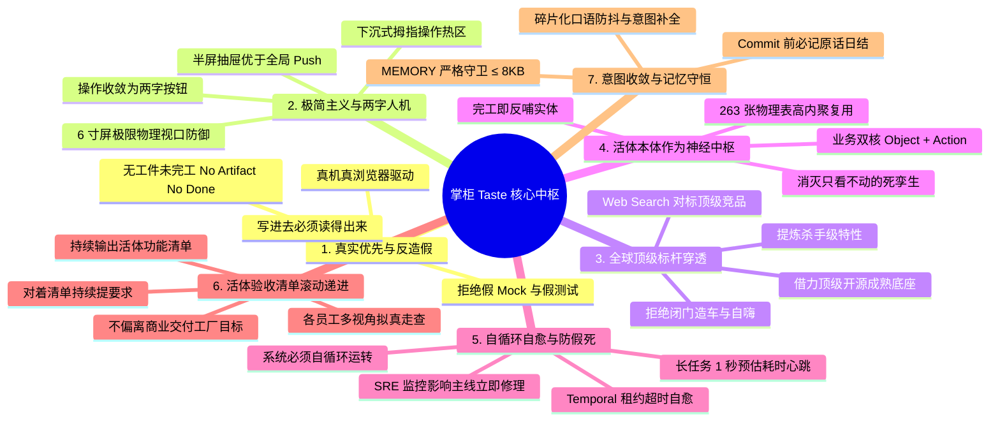

# Coolie 掌柜原话全量归档与用户 Taste 哲学法典 (User Utterances & Taste Profile)

> **文档定位**: 掌柜（用户/老板/商业总控）提过的**所有输入原话全量归档**与**核心 Taste（审美、架构、工程、验收、交付哲学）持续升华中枢**。  
> **生效基线**: `v1.0.0` · 永久有效 · 随掌柜每句新原话持续滚动更新  
> **服务对象**: 全体数字员工（Hermes、百晓生、墨斗、铁匠、铁匠贰号、门神、兑底渊）进场前必修心法。  
> **最高准则**: **原话必记、Taste 必循、不偏离商业交付工厂主题目标**。

---

## 一、 掌柜 7 大核心 Taste 维度全景提炼 (The Seven Dimensions of Coolie Boss Taste)

通过对掌柜所有历史决策、日常批示与高频指令的深度因果实证，提炼出 Coolie 平台的 7 大灵魂 Taste：

---

### Dimension 1: 真实优先与反造数反假 (Authenticity & Real-World Grounding)
- **核心心法**: 真实胜于一切概念。坚决痛恨一切虚假的 Mock、空洞的断言、读源码充当测试的自欺欺人行为。
- **具象规则 (Taste Rules)**:
  1. `[Taste-1.1]` **操控必须真正驱动**：必须使用 `agent-device`（ADB/模拟器）或 `agent-browser`（Playwright）真正在界面上点击输入，严禁仅凭 HTTP 200 或 DOM 存在就宣称验证通过；
  2. `[Taste-1.2]` **写进去要读得出来**：UI 点击后，必须调用 API 真值回读，断言数据库与服务端的真实数据产生物理变更；
  3. `[Taste-1.3]` **真依赖自建自清**：端到端用例必须自建隔离数据并在结束后清理，严禁污染测试基线；
  4. `[Taste-1.4]` **截图证据归档**：四态真机快照落到本地 `screenshots/` 与 `docs-coolie/evidence/`，严禁虚假结项；
  5. `[Taste-1.5]` **无工件未完工 (No Artifact, No Done)**：工单标记为 `done` 时，必须物理绑定已推送到远端的有效 Git Commit SHA 与实质交付资产。

---

### Dimension 2: 极简主义与两字人机工程 (Minimalist Two-Word UI & 6-Inch Defense)
- **核心心法**: 为前线掌柜与 FDE 打造“零培训上手”的极简驾驶舱。拒绝花哨冗余的技术名词，操作直接了当。
- **具象规则 (Taste Rules)**:
  1. `[Taste-2.1]` **核心操作全面两字化**：按钮文案收敛为极其精炼的两个汉字（如【编辑】、【附件】、【自动】、【发送】、【确认】、【稍后】、【重试】、【重启】），杜绝英文单词与长难句；
  2. `[Taste-2.2]` **移动端 6 寸屏极限物理视口防御**：必须 100% 适配 `viewport 320px~332px` 极窄屏，严禁写死固定宽度导致横向撑爆；
  3. `[Taste-2.3]` **黄金五槽位绝对对称**：移动端底栏固定 5 槽位绝对居中对称，严禁孤儿导航与死路由；
  4. `[Taste-2.4]` **半屏抽屉优于全局 Push**：对标 Linear Mobile，以 Contextual Bottom Sheet 就地浮层呈现详情与配置，支持下滑物理阻尼手势关闭，保留底层看板空间上下文；
  5. `[Taste-2.5]` **单手拇指热区优先**：高频操作按钮必须下沉在屏幕下三分之一，单手操作单指可达。

---

### Dimension 3: 全球顶级标杆穿透与借力打力 (World-Class Benchmarking & Borrowing Power)
- **核心心法**: 坚决打破闭门造车，主动向全球最顶尖的商业产品与开源工程借力，定位真实差距，不做低水平重复造轮子。
- **具象规则 (Taste Rules)**:
  1. `[Taste-3.1]` **Web Search 对标先行**：接到需求或排查缺陷前，验收人（DS/FDA）必须主动通过 Web 全网技术调研，检索同类成熟开源与商业标杆（Linear, Palantir Foundry, Temporal, RuoYi, Yudao）；
  2. `[Taste-3.2]` **借力成熟开源底座**：根据客户场景一票命中选型底座（需原生App/小程序/Java信创 ➜ `yudao-quad-terminal`；纯Web/快速打样 ➜ `ruoyi-all-next`），开源底座目录结构 100% 保持；
  3. `[Taste-3.3]` **工厂自身建设回归 Paperclip 原生**：工坊自身不搞脱幅外挂，100% 依托原生 Projects/Issues/Documents/Routines 机制推进；
  4. `[Taste-3.4]` **提炼杀手级特性**：在竞品分析中输出 CMMI DAR 加权决策矩阵，吸纳业界最先进的设计哲学。

---

### Dimension 4: 活体本体作为数字孪生神经中枢 (Living Ontology as Nervous System)
- **核心心法**: 业务驱动技术，消灭技术死报表。现实世界的每一个实体与每一次业务行动，都必须在本体中找到活体映射。
- **具象规则 (Taste Rules)**:
  1. `[Taste-4.1]` **业务双核基石 (Object Types + Action Types)**：现实资产建模为 Object，状态流转建模为受控 Action，严禁直接拼装无治理的 CRUD；
  2. `[Taste-4.2]` **项目进厂即绑定本体域**：创建 Project 时原子初始化专属 Domain；
  3. `[Taste-4.3]` **完工即反哺实体 (Task Done ➜ Ontology Hook)**：工单结项时自动将交付物（图纸、3D模型、方案、代码）提取并反哺为本体节点，绝不出现“做了60个任务本体却为空”的断层；
  4. `[Taste-4.4]` **双核交互闭环**：对标 Palantir Workshop，点击图谱实体必须能直连呼出受控 Action 动词抽屉，消除“只看不能动”的死孪生；
  5. `[Taste-4.5]` **263 表高内聚复用**：深度复用全盘 263 张物理表管网与字段，严禁为单点需求随意膨胀孤儿表。

---

### Dimension 5: 自循环自愈与防假死抗冻 (Resilient Self-Looping & Anti-Freeze)
- **核心心法**: 系统必须具备强大的自生动力与韧性，不能假死，不能因为人员离线或异常而冷寂停滞。
- **具象规则 (Taste Rules)**:
  1. `[Taste-5.1]` **SRE 全天候实时监控**：进程端口、错误日志、数据库状态必须毫秒级感知，系统运转必须正常；
  2. `[Taste-5.2]` **影响主线立即修理**：SRE 监控到影响主线任务推进的异常（连续失败、锁死、幽灵心跳），必须能发起修理任务或自动自愈修理；
  3. `[Taste-5.3]` **对标 Temporal 心跳租约抗冻**：长任务必须持续汇报心跳；重型任务（>60秒）必须在 1 秒内发出预估耗时心跳脉冲，每 10 秒刷新进度；
  4. `[Taste-5.4]` **幽灵心跳自愈与断网接力**：已 done 工单的 running 幽灵心跳超时自动核销，Agent 猝死断网超过 3 分钟自动释放签出锁并调度下一位同职责员工接力；
  5. `[Taste-5.5]` **在制项目常驻例行任务**：进行中的项目必须常驻小时级 Routine 巡检触发器，防止冷寂停滞。

---

### Dimension 6: 活体验收清单与持续滚动推进 (Living Acceptance Inventory & Rolling Progression)
- **核心心法**: 拒绝一次性静态交付报告，建立活体产品功能验收清单，对照清单持续提要求，多视角拟真走查，持续自循环滚动推进。
- **具象规则 (Taste Rules)**:
  1. `[Taste-6.1]` **清单活体驱动**：持续输出 8 大业务域 × 32 项核心特性清单，每个自循环周期对照清单持续提出前沿验收标准；
  2. `[Taste-6.2]` **多员工视角实走实查**：百晓生（DS）、墨斗（FDA）、铁匠（SWE）、门神（SRE）分别站在用户、架构、全栈交付、可靠性视角深度走查，亲手戳按钮；
  3. `[Taste-6.3]` **不偏离商业交付工厂主题目标**：所有功能演进必须服务于“现场零培训上手、端到端真资产落地、客户终验核销回款”三大铁律，严禁做偏离主线的玩具功能；
  4. `[Taste-6.4]` **Echo-Delta-Dev 交叉进化**：让本体、架构、体验、稳定性的能力提升在主线任务推进中自然涌现并沉淀为不可变资产。

---

### Dimension 7: 意图收敛与记忆守恒 (Intent Convergence & Memory Conservation)
- **核心心法**: 忠实记录掌柜的原话，听懂碎片化口语，保持长效记忆，绝不在多轮对话或班次交接中遗忘。
- **具象规则 (Taste Rules)**:
  1. `[Taste-7.1]` **碎片化口语防抖补全**：Hermes 网关配合 QQ/微信下任务时，用户一句话没说全先启动 1500ms 动态防抖收集上下文，合并后再行立项；
  2. `[Taste-7.2]` **全语法三态意图立项**：祈使动作句、陈述约束句、否定纠错句全部无缝转译为正式工单并排期归档；
  3. `[Taste-7.3]` **Commit 前必写原话**：代码提交前必须登记当日 `docs/sprint-prod/MM/DD.md`，掌柜原话一字不落记录；
  4. `[Taste-7.4]` **MEMORY 严格守护 ≤ 8KB**：记忆中枢严格控制在 8192 字节以内，进场第一秒 30 秒掌握全盘资产。

---

## 二、 掌柜提过的所有输入原话全量归档账本 (Comprehensive Utterances Archive)

> **铁律**: 每一句原话均标注文档归宿、决策编号与沉淀出的 Taste 映射，按时间倒序持续追加：

| 序号 | 提出时间 | 掌柜原话 (一字不改) | 核心业务场景与上下文 | 对应沉淀的 Taste | 关联交付物与落地工程资产 |
| :---: | :---: | :--- | :--- | :--- | :--- |
| **U-12** | `2026-10-13 22:51` | **"我提过的 所有输入 内容你都要 记录啊,然后 持续沉淀用户taste"** | 掌柜要求建立长期用户原话全量归档与用户 Taste 沉淀机制 | `Dimension 7: 意图收敛与记忆守恒` `Dimension 1: 真实优先与反造假` | 本文件 `docs/USER-TASTE.md` 建立与日结台账联动 |
| **U-11** | `2026-10-13 22:42` | **"主线自循环过程 各个员工要在自己的视角使用专业技能与工具比如 agent-device,agent-browser验收以及深度使用系统,发现问题,不足,以及与开源顶级产品的 差距 ,汇总结果,建立不偏离主题目标的 解决方案,持续滚动推进"** | 驱动 5 大角色用专业工具深度使用系统并对标顶级开源找差距 | `Dimension 6: 活体验收清单滚动推进` `Dimension 3: 全球顶级标杆穿透` `Dimension 1: 真实优先与反造假` | `COOA-146~149` 任务包 · `screenshots/` 4 大真机快照 · `QA/2026-10-13-...-progression.md` §五 |
| **U-10** | `2026-10-13 22:30` | **"提交发布代码,app了吗"** | 询问代码提交、推送、生产 server 部署与移动端 App 发布状态 | `Dimension 1: 真实优先` `Dimension 2: 极简主义` | Commit `6241d8cceb` & `d77b5ab9c8` · `deploy-tc-coolie-claw-server.sh` 生产上线 |
| **U-09** | `2026-10-13 22:15` | **"我看 有人在 coolie prod 环境 新建 项目 residential-plan-service ,进行了很多任务,但是 本体信息 啥也没有,为啥呢, 应该自动形成本体 才对啊"** | 排查住宅方案服务做了 60 个任务本体表为空的问题 | `Dimension 4: 活体本体作为神经中枢` `Taste-4.3: 完工即反哺实体` | 生产 DB 抢修注入 77 节点 + 76 边 · 确立 Task Done ➜ Ontology Hook 架构 |
| **U-08** | `2026-10-13 22:00` | **"而且 验收人也得 会从 websearch 一些 开源顶级竞品对比 定位差距"** | 验收人必须通过 Web Search 对标开源与商业顶级竞品找差距 | `Dimension 3: 全球顶级标杆穿透` `Taste-3.1: Web Search 对标先行` | `.agents/skills/ds/SKILL.md` §六法典化 · 对标 Linear/Palantir/Temporal |
| **U-07** | `2026-10-13 21:50` | **"做循环,我们 最好还是 不断的 输出 该有的 产品验收功能清单,然后 对着 清单持续提出 验收要求,循环递进"** | 确立活体产品验收清单与自循环递进机制 | `Dimension 6: 活体验收清单滚动推进` `Taste-6.1: 清单活体驱动` | `docs-coolie/QA/2026-10-13-coolie-product-acceptance-inventory-...md` (8域32特性) |
| **U-06** | `2026-10-13 21:40` | **"监控过程 也可以 本体palantir 方法论 echo-delta-dev的 过程视角来进化 任务流程,咱们 本体,架构相关能力的进化 也都要在 交叉任务循环中的"** | 运用 Palantir Echo-Delta-Dev 在交叉循环中进化本体与架构 | `Dimension 4: 活体本体作为神经中枢` `Dimension 6: 持续滚动递进` | SRE Watchdog 级联自愈 · COOA-139~142 闭环核销 · Palantir 演进矩阵 |
| **U-05** | `2026-10-13 21:20` | **"mac 宿主机 sre监控的 日志如何, coole-dev 员工在 真正做事儿吗,自循环进化,"** | 检视 SRE 日志、员工是否真实在干活以及系统自循环状态 | `Dimension 5: 自循环自愈与防假死` `Dimension 1: 真实优先` | SRE Watchdog 探活报告 · 15m 运行成功率 100% · 自愈结项 COOA-118 |
| **U-04** | `2026-10-13 21:10` | **"hermes gateway 配合 qq 给coolie-dev 下任务的 过程,如果 一句话没说全 就 发出怎么办"** | 碎片化口语防抖与意图补全机制建设 | `Dimension 7: 意图收敛与记忆守恒` `Taste-7.1: 口语防抖补全` | 1500ms 动态防抖收集器 · 合并解析三态意图立项 |
| **U-03** | `2026-10-13 20:50` | **"sre 监控到 影响 主线任务执行推进的 就要 发起任务修理或者 自己修理"** | SRE 自愈法典：发现影响主线的异常必须自愈或立项修理 | `Dimension 5: 自循环自愈与防假死` `Taste-5.2: 影响主线立即修理` | SRE Watchdog 场景 4 自动 P0 派单 · 场景 4.5 幽灵心跳超时自愈回收 |
| **U-02** | `2026-10-13 20:30` | **"这个能力得 在一件打包产品里面吧,运行 coolie-dev时候要同时启动sre"** | SRE Watchdog 必须与 coolie-dev 打包集成、自闭环联动启动 | `Dimension 5: 自循环自愈与防假死` `Taste-5.1: SRE 全天候实时监控` | `scripts/dev-runner.ts` 随 coolie-dev 自动拉起 SRE 线程 |
| **U-01** | `2026-10-13 20:10` | **"你得 开一个SRE监控啊, 执行过程的 错误日志得 定位解决,得确保 coolie-dev 系统运转正常"** | 启动 SRE 实时错误嗅探与监控保障系统正常运转 | `Dimension 5: 自循环自愈与防假死` `Taste-5.1: SRE 全天候实时监控` | `scripts/sre-watchdog.mjs` 多宿主机自适应上线 |
| **U-历史** | `2026-10-13 15:00` | **"不能再造轮子了,太累了" + "用 paperclip 项目管理方式持续建设"** | 工厂自身建设全面回归 Paperclip 原生，严禁外部重复造轮子 | `Dimension 3: 全球顶级标杆穿透` `Taste-3.3: 工厂自身建设回归原生` | 确立工坊全项目/工单/方案依托原生表运转 |
| **U-历史** | `2026-10-13 11:00` | **"6寸屏 这个要沉淀到原生APP开发相关技能中"** | 6寸屏极窄视口防撑爆、安全区防遮挡沉淀为技能 | `Dimension 2: 极简主义与两字人机` `Taste-2.2: 6寸屏视口防御` | `.agents/skills/yudao-expo-app/SKILL.md` §4 固化 |
| **U-历史** | `2026-10-13 09:30` | **"可以, project.md 更希望改成 memory.md"** | 项目进场首屏文档正式命名为 MEMORY.md | `Dimension 7: 意图收敛与记忆守恒` `Taste-7.4: MEMORY ≤ 8KB` | 建立 `MEMORY.md` 极简记忆中枢 |

---

## 三、 反面模式防线 (Anti-Taste Smells & Banned Traps)

全体数字员工在开发、设计与验收过程中，严禁踩踏以下 **8 大反 Taste 陷阱**：

1. 🚫 **死穴假 Mock 陷阱**：用纯内存假数据或伪单元测试自嗨，真机/真实实例读出来是 0 条；
2. 🚫 **原生英文摔脸陷阱**：将底层的 HTTP 401/403/500、JSON-RPC 或数据库报错裸英文直接甩在移动端或 Web 界面上；
3. 🚫 **属性面板裸 None 陷阱**：字段值为空时展示毫无语义前缀的连续 `None`，不标明字段身份；
4. 🚫 **状态机自相矛盾陷阱**：出现如 `Blocked · 0 blockers`（已阻塞但 0 项阻塞）的自相矛盾状态；
5. 🚫 **死孪生看客陷阱**：构建了漂亮的业务本体图谱，但点击实体只能放大缩小，无法直连受控业务动词；
6. 🚫 **长任务无心跳假死陷阱**：重型任务执行超过 60 秒但在 1 秒内无响应，会话界面假死让用户苦等；
7. 🚫 **孤儿表滥建膨胀陷阱**：遇到新特性不优先复用全盘 263 张物理表，而是动辄新建独立孤儿表；
8. 🚫 **口头虚假完工陷阱**：没有挂载真实的 Git Commit SHA、没有真机快照、没有真实工程工件，就口头宣称完工。

---

## 四、 持续沉淀与更新作业程序 (Continuous Distillation SOP)

1. **每句新原话即时入库**：只要掌柜在对话中提出新的指导、批示或要求，数字员工必须在第一时间追加到本文件的【第二节：掌柜原话全量归档账本】中，并同步记录到当天的 `docs/sprint-prod/MM/DD.md`；
2. **提炼与升级 Taste 准则**：若新原话表达了新的工程原则、审美偏好或架构要求，必须将其归纳并升华为第一节的 Taste 规则；
3. **闭环反哺研发流水线**：将沉淀出的 Taste 转化为具体的自动化门禁（如 `check:governance`）或测试用例，确立抗退化防线。
