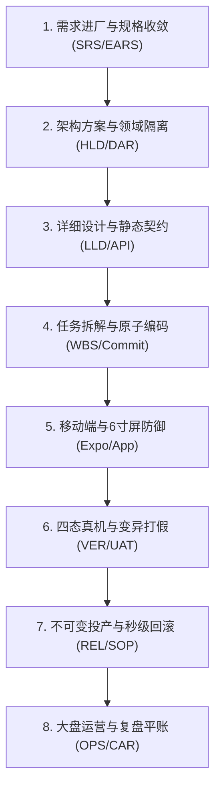

# Coolie 工坊全生命周期 8 环节标准作业流程 (Lifecycle SOP)

> **最高公理**: 软件交付工厂从 0 到 1 商业交付全生命周期，严格遵循 CMMI 5 高成熟度、Palantir 活体本体与 Paperclip 原生控制面三位一体标准。  
> **核心铁律**: 无工件不完工 (No Artifact, No Done)；单一人原子签出锁；质量门禁一票否决权。

---

## 全生命周期 8 环节全景速览

---

## 环节 1: 需求进厂与规格收敛 (Requirements Intake & SRS)

- **核心目标**: 消除二义性，把客户/掌柜原话转译为严格的 EARS 语法软件需求规格。
- **守门员**: 掌柜 / PM + 墨斗 (FDA 前线架构师)
- **标准流程**:
  1. 接收原话，写入需求简报 (Brief)；
  2. 运用 EARS 语法标注无二义性需求：`[前提] [触发] 系统应当 [动作]`；
  3. 建立需求双向跟踪矩阵 (RTM)，关联用户故事与验收指标；
  4. 评审签署 **G1 需求门禁**。
- **强制交付物**:
  - `docs/02_requirements/software-requirements.md` (SRS)
  - Paperclip Issue 上的 `spec` 字段或关联 `spec` 文档
- **权威 Skill**: `cmmi-req-spec`, `requirements-capture`, `ears-spec-writer`

---

## 环节 2: 架构方案与领域隔离 (Architecture & Isolation)

- **核心目标**: 在写第一行代码前，将组织/租户隔离、领域边界、RBAC 与事务守恒画死。
- **守门员**: 墨斗 (FDA 前线架构师，持有一票否决权)
- **标准流程**:
  1. 梳理业务实体 (Object Types) 与业务动词 (Action Types)；
  2. 确立多组织/企业数据行级物理隔离拦截方案；
  3. 针对关键技术方案执行 CMMI DAR 加权决策打分 (选型论证)；
  4. 评审签署 **G2 架构门禁**。
- **强制交付物**:
  - `docs/03_design/architecture-design-hld.md` (HLD)
  - `docs/03_design/dar-evaluations/` (DAR 加权选型矩阵)
- **权威 Skill**: `cmmi-tech-solution`, `fda`, `dar-decision-matrix`

---

## 环节 3: 详细设计与静态契约 (Detailed Design & Contracts)

- **核心目标**: 以编译器与静态守卫拦截契约漂移，实现前后端/跨端 0 编译报错。
- **守门员**: 铁匠 (Core SWE 核心研发工程师)
- **标准流程**:
  1. 固化统一 OpenAPI 3 / Knife4j 接口契约；
  2. 自动生成前端/移动端强类型 TypeScript SDK；
  3. 静态检查模块单向依赖方向与 0 类型报错；
  4. 签署 **G3 编译契约门禁** (`pnpm -r typecheck` 100% 绿灯)。
- **强制交付物**:
  - `docs/03_design/interface-contracts/` (API 契约定义)
  - 自动编译生成的 SDK 类型包
- **权威 Skill**: `cmmi-detailed-contracts`, `core-swe`, `yudao-contract-sync`

---

## 环节 4: 任务拆解与原子编码 (WBS & Atomic Delivery)

- **核心目标**: 单人原子签出，1 Task = 1 Commit，严格记录掌柜原话日结。
- **守门员**: 铁匠 (Core SWE) / 本地匠人团队
- **标准流程**:
  1. 项目分解为 WBS 工作包并提 Paperclip Issue；
  2. 派单并执行 `paperclipCheckoutIssue` 抢占单人原子锁；
  3. 最小范围修改代码并自测；
  4. 提交前必先登记 `docs/sprint-prod/MM/DD.md` (掌柜原话与决策)；
  5. 规范 Commit，将代码与 Issue Work Product 双向挂载。
- **强制交付物**:
  - Git Commit SHA (严格对应 Issue)
  - `docs/sprint-prod/MM/DD.md` (当日决策账本)
  - Issue Work Products 实体
- **权威 Skill**: `swe-delivery-flow`, `spec-driven-dev`, `cmmi-wbs-milestone`

---

## 环节 5: 移动端与 6 寸屏防御 (Mobile Native & Small Viewport)

- **核心目标**: 极限视口防御，保障在 320px~332px 物理真机上无撑爆、无遮挡、零白屏。
- **守门员**: 门神 (FDSE 前线部署) + 铁匠 (Core SWE)
- **标准流程**:
  1. 界面元素严格遵循两字极简 UI 与黄金 5 槽位对称；
  2. 容器宽度锁定 `calc(100vw - 32px)`，严禁写死固定大宽度；
  3. 顶部与灵动岛采用 `useSafeAreaInsets` 动态最大值防遮挡；
  4. 跨顶级域名/隔离域页面禁用客户端软路由 `<Link>`，必须用物理 `<a>`。
- **强制交付物**:
  - 原生 Expo App (Clients) 构建代码
  - 320px~332px 视口断言代码
- **权威 Skill**: `yudao-expo-app` §4, `minimalist-ui-and-cmmi-governance`

---

## 环节 6: 四态真机与变异打假 (Verification & Anti-Mock)

- **核心目标**: 用户视角全链路探路，穷举空/满/错/载四态，杀灭假 Mock。
- **守门员**: 百晓生 (DS 部署战略专家，持有一票否决权) + 门神 (FDSE)
- **标准流程**:
  1. 驱动真机/模拟器走查核心业务旅程 (从头到尾走通)；
  2. 截图存证空态、满态、错误态、加载态四态快照；
  3. 运行变异测试杀灭空洞单测与无效断言；
  4. 签署 **G4 验收门禁** 与《客户终验核销单 (UAT)》。
- **强制交付物**:
  - `docs/05_verification/test-summary-report.md` (测试总结报告)
  - 332px/375px 真机多视口截图存证
  - `docs/05_verification/uat-acceptance-certificate.md`
- **权威 Skill**: `cmmi-ver-val`, `agent-device-browser-automation`, `mutation-tester`, `ds`

---

## 环节 7: 不可变投产与秒级回滚 (Immutable Release & Rollback)

- **核心目标**: 7 步无缓存原子投产，确保生产环境制品与测试环境 100% 指纹一致。
- **守门员**: 兜底渊 (PRE-SRE 产品可靠性工程师，持有一票否决权)
- **标准流程**:
  1. 7 处版本号一致性守卫核对 (`scripts/VERSION-CONSISTENCY-CHECK.sh`)；
  2. 执行 Pre-commit 检查与 Git Commit 规范；
  3. 生产服务器拉取最新代码，执行无缓存干净构建 (`--no-cache`)；
  4. 重启系统服务 (`systemctl restart coolie`)；
  5. 执行 7 步健康拨测 (Health Check)；
  6. 固化秒级回滚 SOP。签署 **G5 投产门禁**。
- **强制交付物**:
  - `docs/07_release/system-deployment-sop.md` (投产与秒级回滚 SOP)
  - 生产不可变镜像/二进制指纹与发布日志
- **权威 Skill**: `cmmi-immutable-release`, `sre-release-and-deploy`, `app-release-pipeline`

---

## 环节 8: 大盘运营与复盘平账 (Operations, Finance & Postmortem)

- **核心目标**: 大盘常态化监控探针巡检，预算硬熔断治理，日终平账与故障 5-Whys 闭环。
- **守门员**: 掌柜 / CEO + 财务总监 (Finance) + 兜底渊 (PRE-SRE)
- **标准流程**:
  1. 每日定时拨测系统健康探针与 PM2/systemd 服务状态；
  2. 监控公司与 Agent 预算水位，触发硬熔断即自动暂停；
  3. 财务对账核实充值、流水与消耗账实相符；
  4. 线上故障统一执行 Google SRE 5-Whys 根因分析，固化防退化自动化用例。
- **强制交付物**:
  - `docs/06_cmmi_audit/car-5whys-rca.md` (事故免责复盘报告)
  - 财务对账平账凭单与 SPC 控制图监控日志
- **权威 Skill**: `ceo-company-ops`, `finance-budget-guard`, `postmortem-analyzer`, `cmmi-car-spc-metrics`
