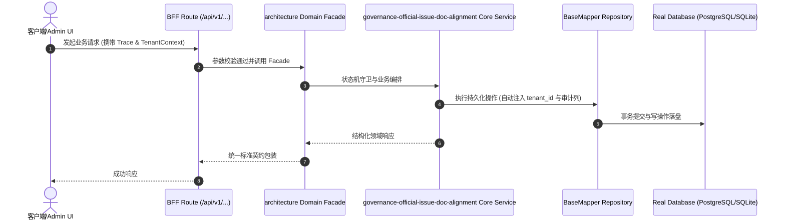

# Technical Architecture & Implementation Plan: 全量架构治理门禁回归 Paperclip 官方 issue_documents 对齐改造

> **Spec-Kit 架构与技术实施方案 (ADD: Architecture & Design Document)**
> 上游真源：`spec.md` (或 `requirements.md`)。技术方案严格支撑需求，严禁反向变更业务目标。
> 状态：`PLAN_APPROVED` | 所属领域：`architecture` | 规格标识：`governance-official-issue-doc-alignment`
> 对应项目宪法：`.specify/memory/constitution.md` (Rule 0.2 模式复用 / Rule 0.6 真实测试驱动)

---

## 1. 关键不变量与防御性约束 (Key Invariants & Guards)

1. **官方主线零侵入** —— 控制面协同完全走官方 issue_documents 路由与数据模型，不向 upstream issues 表强塞私有字段

## 2. 领域架构边界与调用拓扑 (Architecture Topology & Flows)

flowchart TD
  GitSpec["Git 单一真理源 (docs/specs/)"] -->|speckit sync| IssueDocs["Paperclip 官方 issue_documents"]
  IssueDocs --> OntologyAudit["本体对账门禁 (harness-ontology-audit)"]
  IssueDocs --> GovAudit["管局审计 Gate 28 (check-governance-audit)"]
  GitSpec --> PreCommit["Pre-Commit 任务白名单门禁"]
  PreCommit --> GitCommit["1 Task = 1 Commit 不可变凭据"]

### 核心业务时序图 (Archify Mermaid Flow)

## 3. 数据模型与持久化契约 (Data Model & Tables)

实体结构严格遵循底座 8 大审计底座字段规范：
- `id` (主键)
- `tenant_id` (多租户标识)
- `creator` / `create_time` (创建人/时间)
- `updater` / `update_time` (更新人/时间)
- `deleted` (逻辑删除标识)
- `version` (乐观锁版本号)

### 涉及实体与变更说明
- **documents**: Paperclip 官方原生富文本文档表，承载 spec 与 plan 协同
- **issue_documents**: 工单与文档的多对多关联桥接表 (key: 'spec', 'plan')
- **issues**: 工单主表，spec 与 specKind 标记为渐进淘汰，主架构回归官方纯净结构

## 4. API 契约与权限体系 (API Contracts & Security)

- **HTTP 路由**: `/api/v1/architecture/governance-official-issue-doc-alignment`
- **权限标识**: `architecture:governance-official-issue-doc-alignment:manage`

## 5. 状态机流转与边界守卫 (State Machine Transitions)

- 检查中：打印各 Gate 进度。
- 通过：输出绿色 PASS 标记。
- 阻断：输出红色 FAIL 标记并非零退出。

## 6. 技术风险评估与缓解策略 (Technical Risks & Mitigations)

- **风险**: 存量历史脚本或测试可能依赖已废弃字段 -> **缓释策略**: 双写桥接与向后回退机制保障老接口在过渡期内 100% 兼容返回
