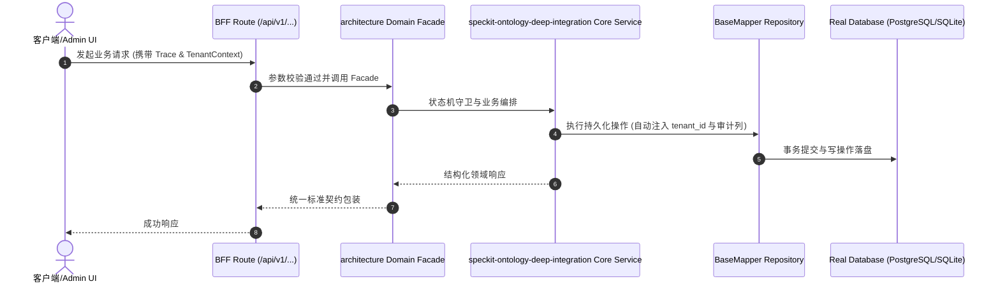

# Technical Architecture & Implementation Plan: Spec-Kit 活体本体建模全生命周期深度接管

> **Spec-Kit 架构与技术实施方案 (ADD: Architecture & Design Document)**
> 上游真源：`spec.md` (或 `requirements.md`)。技术方案严格支撑需求，严禁反向变更业务目标。
> 状态：`PLAN_APPROVED` | 所属领域：`architecture` | 规格标识：`speckit-ontology-deep-integration`
> 对应项目宪法：`.specify/memory/constitution.md` (Rule 0.2 模式复用 / Rule 0.6 真实测试驱动)

---

## 1. 关键不变量与防御性约束 (Key Invariants & Guards)

1. **反死按钮不变量 (INV_NO_DEAD_BUTTON)** —— 界面 actionPoints 引用的 behaviorRef 必须在 M2 behaviors 中完全存在
2. **状态跃迁守恒不变量 (INV_LIFECYCLE_BOUND)** —— M2 behavior postconditions 变更的状态必须在 M1 lifecycle 允许枚举内

## 2. 领域架构边界与调用拓扑 (Architecture Topology & Flows)

flowchart TD
  SpecNew["speckit new --ontology"] --> OntologyYaml["七模型声明 YAML (ontology/)"]
  OntologyYaml --> SpecBuild["speckit build (spec-ontology-driver)"]
  SpecBuild --> DesignMd["design.md (注入 Mermaid ER + M2 契约表)"]
  OntologyYaml --> SpecLint["speckit check / ontology lint"]
  SpecLint --> DeadButtonGuard{"反死穴/零孤岛审计"}
  DeadButtonGuard -->|通过| PreCommitGate["pre-commit Gate 1.5 挂锁"]
  PreCommitGate --> GitCommit["1 Task = 1 Commit 不可变凭据"]

### 核心业务时序图 (Archify Mermaid Flow)

## 3. 数据模型与持久化契约 (Data Model & Tables)

实体结构严格遵循底座 8 大审计底座字段规范：
- `id` (主键)
- `tenant_id` (多租户标识)
- `creator` / `create_time` (创建人/时间)
- `updater` / `update_time` (更新人/时间)
- `deleted` (逻辑删除标识)
- `version` (乐观锁版本号)

### 涉及实体与变更说明
- **ontology_manifest**: 七模型版本框架与模型清单
- **ontology_seven_models**: M1 (Objects), M2 (Behaviors), M3 (Rules), M5 (Actors), M6 (Flows), MU (Views)

## 4. API 契约与权限体系 (API Contracts & Security)

- **HTTP 路由**: `/api/v1/architecture/speckit-ontology-deep-integration`
- **权限标识**: `architecture:speckit-ontology-deep-integration:manage`

## 5. 状态机流转与边界守卫 (State Machine Transitions)

- 加载中：扫描 specs 与 models 拓扑
- 空数据：提示运行 speckit ontology init
- 出错：明确打印 DEAD_UI_BUTTON 与位置
- 成功：全时序因果链可验证通过

## 6. 技术风险评估与缓解策略 (Technical Risks & Mitigations)

- **风险**: 旧规格缺少 ontology/ 导致 build 失败 -> **缓释策略**: 设计为自适应检测：存在 ontology/ 则增强注入，不存在则保留原有扁平实体生成
