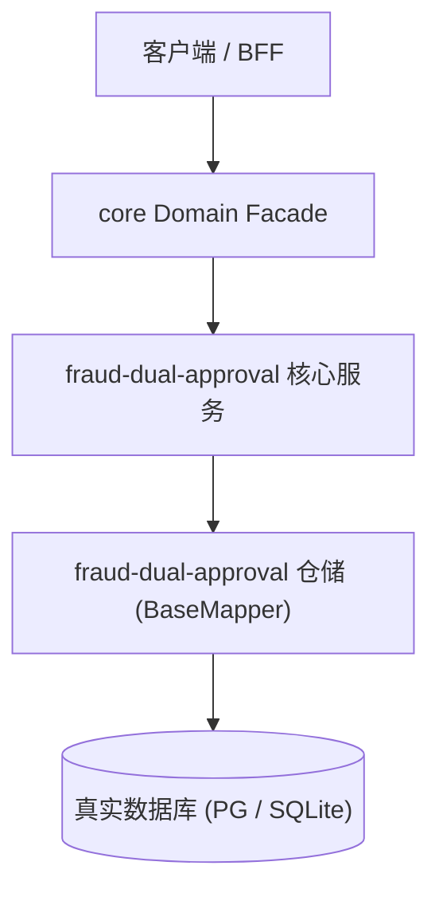

# Design: 高危反诈双人会签

上游：`requirements.md`（本设计严格支撑需求，不得反向修改需求定义）

## 1. 架构总览与拓扑边界

<!-- 待填: 性能加速链路（如 局部缓存、非阻塞 I/O） -->

## 2. 数据模型与持久化契约

- **<!-- 待填: 涉及的表名 -->**: <!-- 待填 -->

## 3. 交互与状态机流转

- 加载中：正常展示。
- 空数据：正常展示。
- 出错：正常展示。
- 成功：正常展示。

## 4. 容错与防御设计

- **风险**: 缓存穿透/击穿/雪崩 -> **缓释策略**: 设置随机 TTL 与互斥锁兜底
