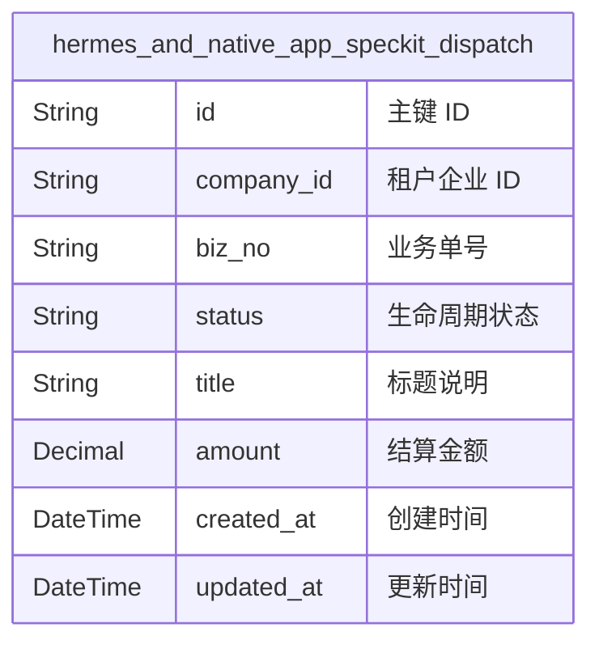
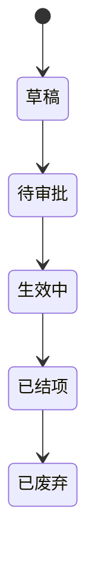
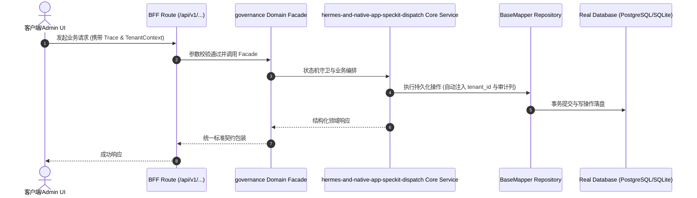

# Technical Architecture & Implementation Plan: Hermes网关与APP原生派活全流程接入Spec-Kit

> **Spec-Kit 架构与技术实施方案 (ADD: Architecture & Design Document)**
> 上游真源：`spec.md` (或 `requirements.md`)。技术方案严格支撑需求，严禁反向变更业务目标。
> 状态：`PLAN_APPROVED` | 所属领域：`governance` | 规格标识：`hermes-and-native-app-speckit-dispatch`
> 对应项目宪法：`.specify/memory/constitution.md` (Rule 0.2 模式复用 / Rule 0.6 真实测试驱动)

---

## 1. 关键不变量与防御性约束 (Key Invariants & Guards)

1. **规格原子性** —— 带有 specKit 的建单请求必须保证物理目录脚手架与 issue_documents 文档初始化一致，失败则记录降级日志但不中断任务创建

## 2. 领域架构边界与调用拓扑 (Architecture Topology & Flows)

Hermes Gateway (QQ/微信/意图解析) / Expo Native App ➔ POST /api/companies/:id/issues (携带 specKit 配置) ➔ server/src/services/speckit-dispatch.ts (触发 scaffold & build) ➔ 物理 docs/specs/ 资产 + 官方 issue_documents (spec/plan) + issue_work_products ➔ 数字员工基于 SDD 规范实施 1 Task = 1 Commit

## 活体本体七模型架构设计 (Living Ontology Topology)

### 1. 领域实体模型 (M1 Object ER Diagram)

### 2. 状态机生命周期跃迁 (State Transition Diagram)
#### 实体 [Hermes网关与APP原生派活全流程接入Spec-Kit] 生命周期图

### 3. 核心业务动词契约清单 (M2 Action Contract Table)
| 行为 ID | 动词名称 | 触发类型 | 前置条件 | 跃迁状态 | 规则守卫 |
| :--- | :--- | :--- | :--- | :--- | :--- |
| `hermes-and-native-app-speckit-dispatch_save_draft` | **保存草稿** | `USER_ACTION` | status in ('草稿', '已驳回') | `status=草稿` | RULE_HERMES_AND_NATIVE_APP_SPECKIT_DISPATCH_MULTI_TENANT_ISOLATION |
| `hermes-and-native-app-speckit-dispatch_submit` | **提交审批** | `USER_ACTION` | status == '草稿'; title != null && title != '' | `status=待审批` | RULE_HERMES_AND_NATIVE_APP_SPECKIT_DISPATCH_MULTI_TENANT_ISOLATION, RULE_HERMES_AND_NATIVE_APP_SPECKIT_DISPATCH_SUBMIT_CHECK |

### 核心业务时序图 (Archify Mermaid Flow)

## 3. 数据模型与持久化契约 (Data Model & Tables)

实体结构严格遵循底座 8 大审计底座字段规范：
- `id` (主键)
- `tenant_id` (多租户标识)
- `creator` / `create_time` (创建人/时间)
- `updater` / `update_time` (更新人/时间)
- `deleted` (逻辑删除标识)
- `version` (乐观锁版本号)

### 涉及实体与变更说明
- **issues**: 承载任务基础信息与工单标识
- **issue_documents**: 官方原生文档表，存储 key: 'spec' 与 key: 'plan' 的 Markdown 内容
- **issue_work_products**: 工件总线表，挂载 docs/specs/ 物理规格文件资源引用

## 4. API 契约与权限体系 (API Contracts & Security)

- **HTTP 路由**: `/api/v1/governance/hermes-and-native-app-speckit-dispatch`
- **权限标识**: `governance:hermes-and-native-app-speckit-dispatch:manage`

## 5. 状态机流转与边界守卫 (State Machine Transitions)

- 加载中：建单加载指示器。
- 空数据：默认无 Spec 模式可秒级提交。
- 出错：Toast 明确提示并降级落单。
- 成功：弹出回执并跳转工单详情。

## 6. 技术风险评估与缓解策略 (Technical Risks & Mitigations)

- **风险**: 离线环境或权限不足导致脚手架生成失败 -> **缓释策略**: speckit-dispatch 采用 try-catch 软降级，保留任务核心生命周期不受阻
