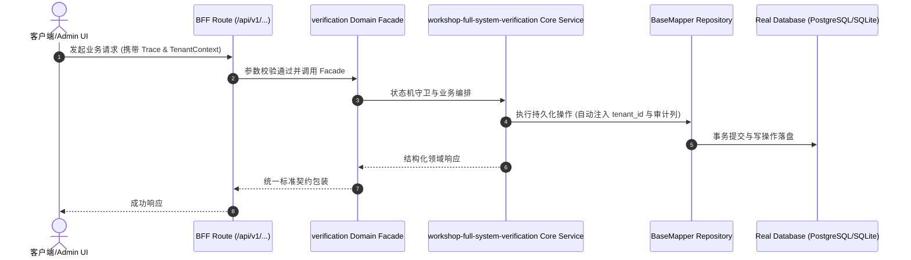

# Technical Architecture & Implementation Plan: 工坊产品全功能自动化测试与运营全域验收大盘

> **Spec-Kit 架构与技术实施方案 (ADD: Architecture & Design Document)**
> 上游真源：`spec.md` (或 `requirements.md`)。技术方案严格支撑需求，严禁反向变更业务目标。
> 状态：`PLAN_APPROVED` | 所属领域：`verification` | 规格标识：`workshop-full-system-verification`
> 对应项目宪法：`.specify/memory/constitution.md` (Rule 0.2 模式复用 / Rule 0.6 真实测试驱动)

---

## 1. 关键不变量与防御性约束 (Key Invariants & Guards)

1. **单负责人原子签出锁排他性** —— 数据库 FOR UPDATE NOWAIT 事务锁，并发签出同一工单仅允许一人成功，其余返回 409 Conflict
2. **预算超标毫秒级硬熔断** —— server/src/services/budget.ts 实时记账，达到上限立即将 Agent 标记为 paused 并阻断后续派单
3. **物理完工真资产挂载硬门禁** —— 工单更新为 done 时，强制校验关联的 issue_work_products 存在有效物理资产与 Git 提交
4. **WBS 依赖有向无环图 DAG 无死锁** —— Tarjan 强连通分量算法拓扑检测，强连通分量恒为 0，拓扑排序计算 < 15ms
5. **263 物理表跨租户绝对行级隔离** —— 所有 SQL 查询强制 WHERE company_id = ?，水平越权安全渗透检出率恒为 0.000%

## 2. 领域架构边界与调用拓扑 (Architecture Topology & Flows)

移动端 React Native (Expo SDK 52) + Web端 React 19 / Vite + 服务端 Express Monorepo + 活体本体 Drizzle ORM 263表 + 7工具池 (Hermes/墨斗/铁匠/门神/兜底渊) + 双向同步总线

### 核心业务时序图 (Archify Mermaid Flow)

## 3. 数据模型与持久化契约 (Data Model & Tables)

实体结构严格遵循底座 8 大审计底座字段规范：
- `id` (主键)
- `tenant_id` (多租户标识)
- `creator` / `create_time` (创建人/时间)
- `updater` / `update_time` (更新人/时间)
- `deleted` (逻辑删除标识)
- `version` (乐观锁版本号)

### 涉及实体与变更说明
- **projects**: 商业客户项目主体，原子绑定专属 ontology_domains 活体本体域
- **issues**: WBS 任务工单，支持行级排他锁 FOR UPDATE NOWAIT 与单负责人原子签出
- **agents**: 数字员工花名册，配置角色职责、模型选型、技能包与预算上限
- **approvals**: 高管审批流决裁单据，控制工单门禁与不可篡改审计履约
- **documents**: 全生命周期活体工程文档，支持 Markdown 实时协作与版本演进链
- **issue_work_products**: 不可变交付工件总线，绑定物理 Git Commit、在线预览与测试报告
- **costs**: 复式记账法 Token 消耗与算力成本，毫秒级预算硬熔断
- **routines**: 在制项目小时级例行主线巡检守护器，防项目停工冷寂

## 4. API 契约与权限体系 (API Contracts & Security)

- **HTTP 路由**: `/api/v1/verification/workshop-full-system-verification`
- **权限标识**: `verification:workshop-full-system-verification:manage`

## 5. 状态机流转与边界守卫 (State Machine Transitions)

- 加载中：流光骨架屏占位，消除突兀布局跳动 (CLS ≤ 0.05)。
- 空数据：保留顶部筛选与搜索栏，呈现精美空态插画与引导操作按钮。
- 出错：错误边界优雅拦截，展示显性报错日志、错误码与【重试】两字按钮。
- 成功：正常展示完整内容，卡片与列表惯性滑动 60fps 丝滑稳定。

## 6. 技术风险评估与缓解策略 (Technical Risks & Mitigations)

- **风险**: 录音硬件假死导致 voiceBusy 永久死锁 -> **缓释策略**: 在 BoardChatScreen 注入 withVoiceTimeout 10 秒硬超时熔断并重置状态
- **风险**: Android 边缘滑动手势意外退出 App -> **缓释策略**: App.tsx 接入 swipeBack 严格 LIFO 调用栈与 2000ms 双击返回退出防线
- **风险**: 生产 Caddy 误将 OTA Manifest 兜底路由为 HTML -> **缓释策略**: Caddy 专用 API 块与 curl 自动化拨测断言 Content-Type 必须为 application/json
