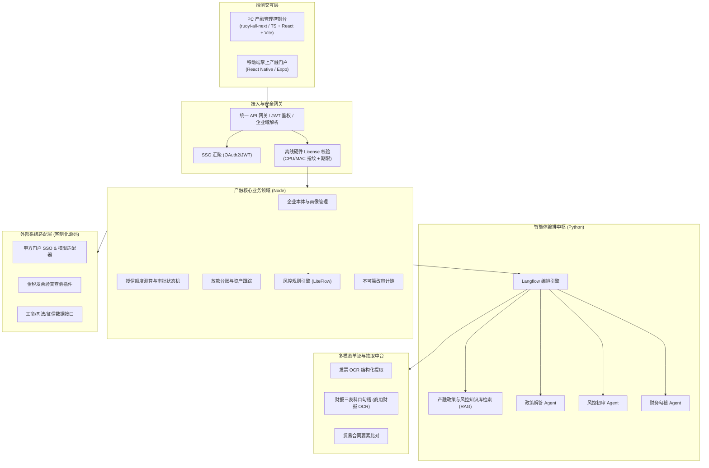

# 产融商业保理与供应链金融智能体系统 系统概要设计与架构决策说明书 (HLD & DAR)

> **所属业务系统**: `SYS_CHANRONG_AGENT`　**本体域**: `enterprise-core`
> **设计责任人**: `emp_fda`（前线架构师）　**生效门禁**: G2 架构隔离与治理门禁 (`gate_g2_arch`)
> **设计基准**: CMMI 3 / IEEE 1016-2009 (SDD) / DAR 加权决策模型
> **技术栈基线**: `langflow-ai/langflow`(编排, MIT) + `xaicd/ruoyi-all-next`(管理控制台底座, MIT) + `node / react / python-vision / docker`

---

## 1. 系统总体架构与拓扑

采用**「管理控制台底座 + 智能体编排中枢 + 多模态单证中台 + 插件式适配层」**四层架构。
管理面与智能体面**运行时分离**：管理面为 Node/TS 控制台，编排面为 Python 编排引擎，二者通过受控契约通信。

**运行时分离契约约束**：管理控制台 (Node) 不得内联编排逻辑；编排引擎 (Python) 不得直连产融业务库。
两者仅通过 `/api/v1/chanrong/*` 契约与 `module-agent-orchestrator` 发布接口交互。此约束是第 2 节隔离红线的落地前提。

## 2. 四条不可逾越的架构边界 (Architectural Invariants)

1. **企业数据物理/逻辑强隔离 (Multi-Company Boundary)**：每条业务记录强制携带 `company_id` 与 `tenant_scope`；
   仓储层强制注入 `company_id` 过滤，严禁跨企业实体越权读取。
2. **财务与授信数据不可篡改守恒 (Immutability & Conservation)**：授信额度流转、发票抵扣金额变动必须满足借贷守恒与事务一致性；
   所有状态机变更生成防篡改哈希链审计，支持全生命周期追溯。
3. **细粒度 RBAC 与智能体权限收敛 (Least Privilege Boundary)**：智能体仅持有只读或建议权限；
   所有涉及资金、额度批复、放款的关键状态变更，必须保留人类双人复核门禁 (Human-in-the-Loop)。
4. **离线私有化运行与专网防护 (Air-Gapped & License Boundary)**：推理、检索、OCR 全部支持内网脱机运行，不回连公网；
   启动时校验本地加密硬件指纹与 License 有效期。

## 3. 技术决策分析报告 (DAR — 多准则加权决策矩阵)

> 评分区间 1–10，加权总分 = Σ(准则得分 × 权重)。权重为本架构组提议值，需与项目经理确认后冻结。

### 3.1 智能体编排引擎选型

| 评价准则 | 权重 | A: Langflow (MIT) | B: Dify (改版 Apache) | C: Coze Studio (Apache) |
| :--- | ---: | ---: | ---: | ---: |
| 许可证自由度(私有化交付) | 30% | 10.0 | 6.0 | 9.0 |
| 能力覆盖(编排/工具/API 发布) | 25% | 8.5 | 9.5 | 8.0 |
| 活跃度与社区规模 | 15% | 9.5 | 9.5 | 5.0 |
| 中文生态与文档 | 15% | 7.5 | 10.0 | 8.0 |
| 交付可控性(可改可闭源集成) | 15% | 9.0 | 7.5 | 8.0 |
| **加权总分** | **100%** | **9.03 (中标)** | **8.23** | **7.85** |

**裁定**：Langflow。决定性准则为许可证自由度 —— Dify 采用修改版 Apache-2.0，明文限制多租户环境；
Langflow 为纯 MIT、零附加条款。

### 3.2 管理控制台与企业层底座选型

| 评价准则 | 权重 | A: ruoyi-all-next (自有) | B: 全自研 | C: 采购商业低代码 |
| :--- | ---: | ---: | ---: | ---: |
| 许可可用性 | 25% | 7.0 | 10.0 | 4.0 |
| 组织/RBAC/菜单/子账户既有能力 | 30% | 9.0 | 5.0 | 9.0 |
| 与编排层集成成本 | 20% | 8.5 | 7.0 | 5.0 |
| 可控与可改造 | 25% | 10.0 | 10.0 | 3.0 |
| **加权总分** | **100%** | **8.65 (中标)** | **7.90** | **5.45** |

**裁定**：ruoyi-all-next。组织/RBAC/菜单/子账户能力正对规范书 `2.3` 前半段，可复用而非自研。
许可为 MIT（零附加条款）；交付包须随附 `LICENSE` 全文与 `Copyright (c) 2026 xaicd`。

### 3.3 财报与单证 OCR 技术路线选型

| 评价准则 | 权重 | A: 采购商用财报 OCR | B: PaddleOCR+MinerU+视觉模型 | C: 传统模板 OCR |
| :--- | ---: | ---: | ---: | ---: |
| ★条款符合度(规范书 2.4) | 40% | 10.0 | 4.0 | 3.0 |
| 财报三表/复杂表格精度 | 25% | 9.5 | 7.0 | 4.0 |
| 私有化可部署性 | 20% | 7.0 | 10.0 | 9.0 |
| 成本 | 15% | 4.0 | 9.0 | 10.0 |
| **加权总分** | **100%** | **8.38 (中标)** | **6.70** | **5.50** |

**裁定**：财报场景按 ★ 条款采购商用财报 OCR；发票、贸易合同等非财报单证使用 PaddleOCR + MinerU。

### 3.4 风控规则引擎选型

| 评价准则 | 权重 | A: LiteFlow (Apache-2.0) | B: Drools (Apache-2.0) | C: 硬编码公式(现状) |
| :--- | ---: | ---: | ---: | ---: |
| 规则可配置(规范书 2.3) | 35% | 9.5 | 9.0 | 2.0 |
| 国产生态与中文文档 | 20% | 9.0 | 5.0 | 8.0 |
| 许可证 | 20% | 10.0 | 10.0 | 10.0 |
| 与审批状态机协同 | 25% | 8.5 | 8.0 | 5.0 |
| **加权总分** | **100%** | **9.25 (中标)** | **8.15** | **5.55** |

**裁定**：LiteFlow。硬编码公式（现 SRS 旧写法）加权得分最低且与规范书「规则配置」冲突，属需求变更，须经 CCB。

## 4. 关键技术风险与应对策略 (RSKM)

| 风险项 | 严重度 | 应对策略与设计保障 |
| :--- | :--- | :--- |
| 甲方门户接口联调受阻 | 高 | 适配器防腐层 (Adapter Pattern) + 完整数据桩，脱离外部老系统依赖 |
| `ruoyi-all-next` MIT 署名义务 | 低 | 交付包随附 `LICENSE` 全文与 `Copyright (c) 2026 xaicd`，漏署属许可违约 |
| ★2.4 商用财报 OCR 被开源替代 | 高 | 已按 DAR 3.3 裁定为采购项；否则须走正式偏离声明 |
| SRS 硬编码风控公式 | 高 | 走 CCB 变更为 LiteFlow 外置规则 |
| 开源许可传染 (AGPL/GPL) | 高 | 选型白名单仅收 MIT/Apache-2.0 |
| 信创硬件算力不足 | 中 | INT4/INT8 量化，显存压至 8GB 内，提供纯 CPU 兜底规则计算 |
| 内网无法下载依赖 | 高 | 交付全包含式离线镜像与离线依赖包 |
| 管理面与编排面双运行时 | 中 | 二者仅经契约通信，各自可独立升级；LLD 固化契约版本与兼容策略 |

## 5. 需求级选型落地表 (REQ → 满足方式 / 许可证 / 风险)

| 需求 | 名称 | 满足方式 | 许可证 | 主要风险 |
| :--- | :--- | :--- | :--- | :--- |
| REQ-CR-001 | 企业本体档案 | 开源底座: ruoyi-all-next + 自研画像 | MIT | 需保留署名；隔离需持久化层强制 `company_id` |
| REQ-CR-002 | 征信与外部数据同步 | 采购数据 + 自研适配 | 商业授权 | 甲方负责采购与授权，乙方仅对接 |
| REQ-CR-003 | 发票智能识别与验真 | 开源: PaddleOCR + 视觉模型；金税走官方接口 | Apache-2.0 | 性能承诺需基准数据支撑 |
| REQ-CR-004 | 财报三表勾稽 | 采购: 商用财报 OCR (★2.4 指定) | 商业授权 | 偏离成本高，预算需投标前落实 |
| REQ-CR-005 | 贸易合同结构化核验 | 开源: MinerU/PaddleOCR + 自研比对 | Apache-2.0 | 合同版式多样，准确率需实测 |
| REQ-CR-006 | 政策法规产品问答 Agent | 开源: Langflow + Milvus 检索 | MIT / Apache-2.0 | 首字延迟为合同级承诺 |
| REQ-CR-007 | 风控初审与合规审查 Agent | 开源 + 自研: Langflow + LiteFlow + 三方数据 | MIT / Apache-2.0 | 结论可追溯性需留痕 |
| REQ-CR-008 | 授信申请与额度测算 | 开源: LiteFlow 规则引擎(替换硬编码) | Apache-2.0 | 需 CCB 变更；硬编码与规范书冲突 |
| REQ-CR-009 | 多级审批与状态机转移 | 开源: Flowable(会签/锁定) | Apache-2.0 | 锁定语义须与业务确认，避免误锁 |
| REQ-CR-010 | 甲方门户 SSO 集成 | 开源汇聚 + 自研适配: OAuth2/JWT | Apache-2.0 | 甲方角色/门户定位歧义(见待决事项) |
| REQ-CR-011 | 审计跟踪与防篡改日志 | 自研(哈希链 + 不可变流水) + Postgres | 无(自研) | 防篡改强度需第三方评审确认 |
| REQ-CR-012 | 离线私有化与 License 授权锁 | 自研(硬件指纹 + 离线签名校验) | 无(自研) | 锁死客户系统，须写入合同附件 |

## 6. 待决事项 (Open Decisions)

> 未决架构问题必须显式登记，不得静默进入实现。

### 6.1 `ruoyi-all-next` 许可证 (已解决，保留审计痕迹)
2026-09-27 实测该仓库为 `NO-LICENSE`，曾构成本项阻塞。业主方已推送 LICENSE，现为 **MIT**（零附加条款，`Copyright (c) 2026 xaicd`），阻塞解除。
**遗留义务**：交付包必须随附 `LICENSE` 全文，漏署即构成许可违约。

### 6.2 「若依」定位歧义 (阻塞架构)
现有 SRS 将若依定位为**甲方现有门户**（REQ-CR-010），而选型基于 `ruoyi-all-next` **自建管理控制台**。
二者架构含义不同（代码归属、交付物、验收方式均不同）。**决策**：需明确「自建控制台 + 适配甲方门户」还是「仅在甲方若依上二次开发」。

### 6.3 REQ-CR-012 硬件指纹 License 锁的合同风险
以 MAC/CPU/主板序列号绑定并拒绝服务，属对客户系统的强控制。**决策**：商务与法务需确认该条已写入合同附件及质保期条款。

### 6.4 需求变更需经 CCB
本 HLD 对 **REQ-CR-008(硬编码→LiteFlow)** 与 **REQ-CR-004(OCR 路线)** 的修正属需求级影响，**须提交 CCB 审议**。

### 6.5 无依据的量化承诺需补基准
现 SRS/HLD 中的具体数字（发票「2 秒内」、问答「1.5 秒首字」等）目前无实测证据。**决策**：投标前补齐基准测试报告或改为相对表述。

---

*本文件由 `emp_fda` 角色依 `cmmi-tech-solution` 技能产出，须通过 `node scripts/check-fork-surface.mjs` (G2 门禁) 方可生效。*
