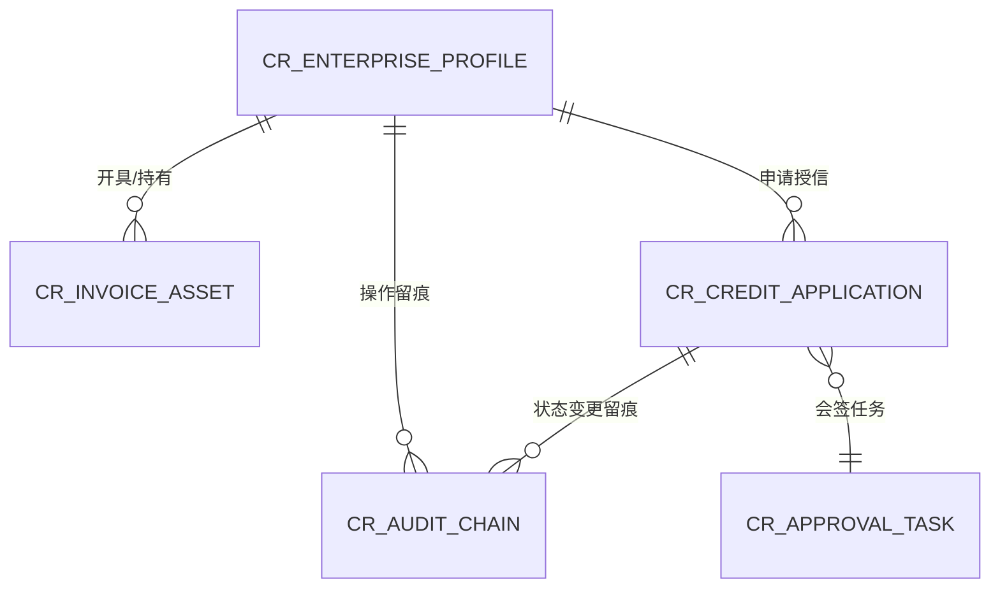

# 产融商业保理与供应链金融智能体系统 数据库物理设计与 ERD 规约

> **所属业务系统**: `SYS_CHANRONG_AGENT`　**本体域**: `enterprise-core`
> **设计责任人**: `emp_fda` / `emp_swe`　**规范**: CMMI TS / IEEE 1016
> **存储**: PostgreSQL（生产） / SQLite（离线轻量）　**字符集**: UTF-8

---

## 1. 八大审计底座列 (Audit Base Columns)

每张业务表**强制继承**以下 8 列，缺一不可（REQ-BASE-002）：

| 列名 | 类型 | 语义 |
| :--- | :--- | :--- |
| `id` | UUID | 主键，高熵 |
| `company_id` | UUID | 企业/租户隔离边界（REQ-BASE-001） |
| `created_at` | TIMESTAMPTZ | 创建时间 |
| `updated_at` | TIMESTAMPTZ | 更新时间 |
| `created_by` | UUID | 创建人（人类或智能体标识） |
| `updated_by` | UUID | 更新人 |
| `is_deleted` | BOOLEAN | 逻辑删除标记 |
| `version` | INT | 乐观锁版本号 |

> 所有跨企业查询在仓储层强制注入 `WHERE company_id = :ctxCompanyId`；任何未携带该过滤的查询在 G2/G3 判红。

## 2. 核心实体关系 (ERD)



## 3. 物理表设计 (DDL)

```sql
-- 1. 企业本体档案 (隔离根实体)
CREATE TABLE cr_enterprise_profile (
    id               UUID PRIMARY KEY DEFAULT gen_random_uuid(),
    company_id       UUID NOT NULL,
    credit_code      VARCHAR(18) NOT NULL,
    enterprise_name  VARCHAR(255) NOT NULL,
    legal_person     VARCHAR(64) NOT NULL,
    registered_capital NUMERIC(15,2) NOT NULL,
    industry_category VARCHAR(64),
    tax_rating       VARCHAR(8)  DEFAULT 'B',
    risk_level       VARCHAR(16) DEFAULT 'NORMAL',
    metadata         JSONB DEFAULT '{}'::jsonb,
    created_at       TIMESTAMPTZ NOT NULL DEFAULT NOW(),
    updated_at       TIMESTAMPTZ NOT NULL DEFAULT NOW(),
    created_by       UUID, updated_by UUID,
    is_deleted       BOOLEAN NOT NULL DEFAULT FALSE,
    version          INT NOT NULL DEFAULT 1,
    UNIQUE (company_id, credit_code)
);

-- 2. 多模态单证与增值税发票台账
CREATE TABLE cr_invoice_asset (
    id               UUID PRIMARY KEY DEFAULT gen_random_uuid(),
    company_id       UUID NOT NULL,
    enterprise_id    UUID NOT NULL REFERENCES cr_enterprise_profile(id),
    invoice_code     VARCHAR(32) NOT NULL,
    invoice_number   VARCHAR(32) NOT NULL,
    billing_date     DATE NOT NULL,
    buyer_name       VARCHAR(255) NOT NULL,
    seller_name      VARCHAR(255) NOT NULL,
    amount_without_tax NUMERIC(15,2) NOT NULL,
    tax_amount       NUMERIC(15,2) NOT NULL,
    total_amount     NUMERIC(15,2) NOT NULL,
    ocr_raw_data     JSONB NOT NULL,
    verification_status VARCHAR(16) DEFAULT 'VALID',
    created_at       TIMESTAMPTZ NOT NULL DEFAULT NOW(),
    updated_at       TIMESTAMPTZ NOT NULL DEFAULT NOW(),
    created_by       UUID, updated_by UUID,
    is_deleted       BOOLEAN NOT NULL DEFAULT FALSE,
    version          INT NOT NULL DEFAULT 1,
    UNIQUE (company_id, invoice_code, invoice_number)
);

-- 3. 产融授信申请与风控工单
CREATE TABLE cr_credit_application (
    id               UUID PRIMARY KEY DEFAULT gen_random_uuid(),
    company_id       UUID NOT NULL,
    enterprise_id    UUID NOT NULL REFERENCES cr_enterprise_profile(id),
    application_no   VARCHAR(64) NOT NULL,
    applied_amount   NUMERIC(15,2) NOT NULL,
    suggested_amount NUMERIC(15,2),
    approved_amount  NUMERIC(15,2),
    loan_term_months INT NOT NULL DEFAULT 12,
    status           VARCHAR(32) NOT NULL DEFAULT 'DRAFT',
    risk_summary     TEXT,
    created_at       TIMESTAMPTZ NOT NULL DEFAULT NOW(),
    updated_at       TIMESTAMPTZ NOT NULL DEFAULT NOW(),
    created_by       UUID, updated_by UUID,
    is_deleted       BOOLEAN NOT NULL DEFAULT FALSE,
    version          INT NOT NULL DEFAULT 1,
    UNIQUE (company_id, application_no)
);

-- 4. 会签审批任务 (人类双人复核)
CREATE TABLE cr_approval_task (
    id               UUID PRIMARY KEY DEFAULT gen_random_uuid(),
    company_id       UUID NOT NULL,
    application_id   UUID NOT NULL REFERENCES cr_credit_application(id),
    approver_id      UUID NOT NULL,
    decision         VARCHAR(16) NOT NULL DEFAULT 'PENDING', -- PENDING/APPROVED/REJECTED
    decided_at       TIMESTAMPTZ,
    created_at       TIMESTAMPTZ NOT NULL DEFAULT NOW(),
    updated_at       TIMESTAMPTZ NOT NULL DEFAULT NOW(),
    created_by       UUID, updated_by UUID,
    is_deleted       BOOLEAN NOT NULL DEFAULT FALSE,
    version          INT NOT NULL DEFAULT 1,
    UNIQUE (company_id, application_id, approver_id)
);

-- 5. 不可篡改审计链 (哈希链)
CREATE TABLE cr_audit_chain (
    id          UUID PRIMARY KEY DEFAULT gen_random_uuid(),
    company_id  UUID NOT NULL,
    entity_type VARCHAR(64) NOT NULL,
    entity_id   UUID NOT NULL,
    action      VARCHAR(64) NOT NULL,
    before_val  JSONB,
    after_val   JSONB,
    actor_id    UUID NOT NULL,
    source_ip   INET,
    prev_hash   CHAR(64) NOT NULL,
    row_hash    CHAR(64) NOT NULL,
    created_at  TIMESTAMPTZ NOT NULL DEFAULT NOW()
);
```

## 4. 索引与约束规范

| 表 | 索引 | 目的 |
| :--- | :--- | :--- |
| `cr_enterprise_profile` | `(company_id)` | 隔离过滤加速 |
| `cr_invoice_asset` | `(company_id, enterprise_id)` | 按企业聚合发票 |
| `cr_credit_application` | `(company_id, status)` | 审批待办查询 |
| `cr_approval_task` | `(company_id, application_id)` | 会签签字校验 |
| `cr_audit_chain` | `(company_id, entity_type, entity_id)` | 血缘追溯 |

**守恒与并发约束**：
- 授信额度变更、发票抵扣金额变动必须在**同一事务**内，并写入 `cr_audit_chain`（写审计失败即整体回滚）。
- `version` 乐观锁防止并发覆盖；会签任务通过 `UNIQUE(application_id, approver_id)` 防止同人重复签字。
- `cr_enterprise_profile.credit_code` 在 `company_id` 维度唯一，杜绝跨企业主数据混用。

## 5. 高熵主键与离线兼容

- 主键统一 UUID v4（`gen_random_uuid()`），避免自增主键暴露业务量并支持多端离线写入合并。
- 离线轻量模式（SQLite）由同一套 schema 生成，`JSONB` 降级为 `TEXT`，`INET` 降级为 `TEXT`；隔离过滤语义不变。
