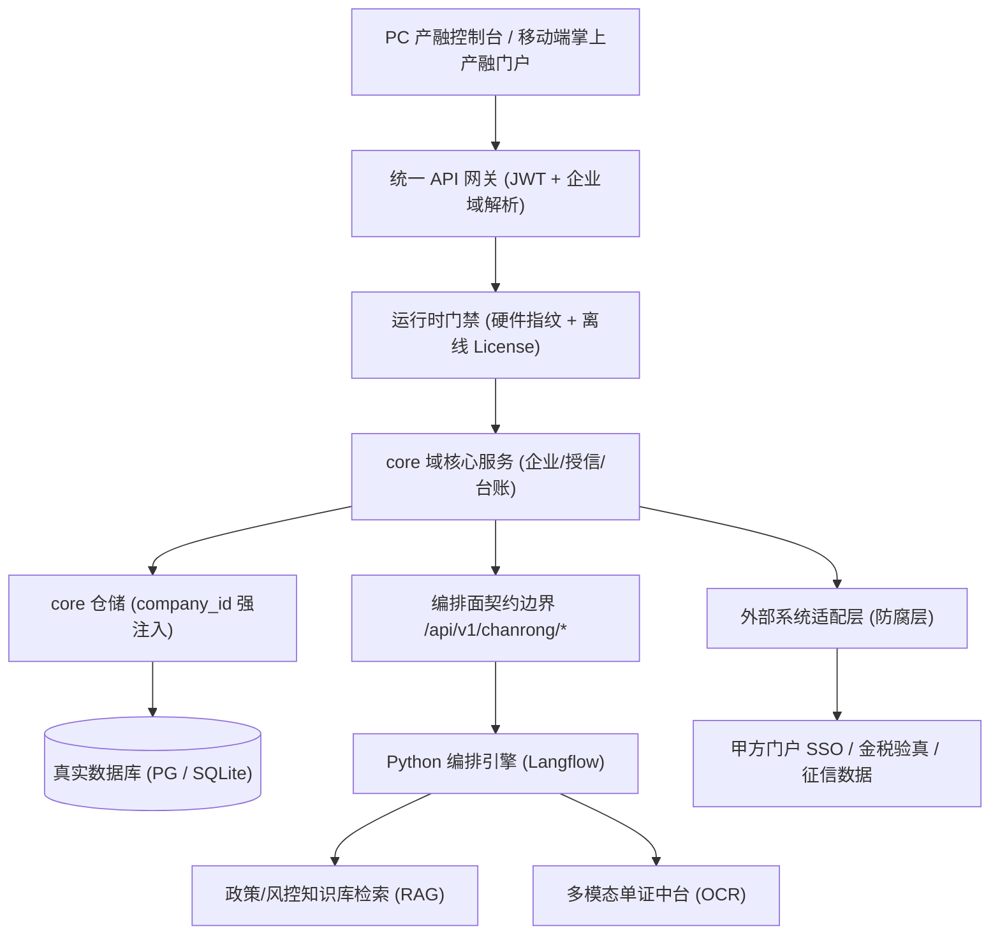
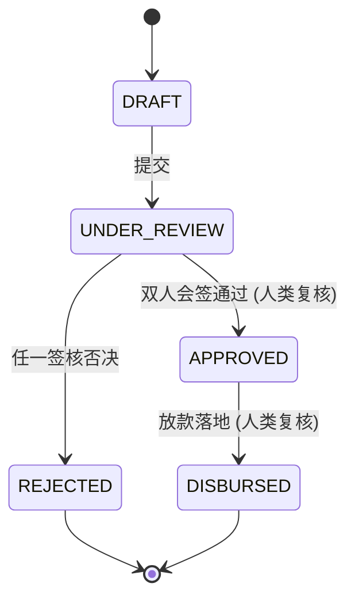

# Design: 产融商业保理与供应链金融智能体系统 初始工程地基与规范基线

上游：`requirements.md`（本设计严格支撑需求，不得反向修改需求定义）
设计责任人：`emp_fda`（前线架构师）　设计基准：CMMI 3 / IEEE 1016-2009 (SDD)

## 1. 架构总览与拓扑边界

采用**「管理控制台底座 + 智能体编排中枢 + 多模态单证中台 + 插件式适配层」**四层架构。
管理面与编排面**运行时分离**：管理面为 Node/TS 控制台，编排面为 Python 编排引擎，二者仅经受控契约通信（REQ-BASE-006）。



**模块边界与依赖方向**（单向，禁反向依赖）：

| 模块 | 职责 | 允许依赖 | 禁止依赖 |
|---|---|---|---|
| `core-domain` | 企业/授信/台账领域模型 | 无（纯领域） | 编排面、适配层、基础设施 |
| `core-service` | 应用服务与事务边界 | `core-domain` | 直接外部 SDK |
| `core-repo` | 持久化，强制注入 `company_id` | `core-domain` | HTTP / 编排面 |
| `agent-bridge` | 编排面契约客户端 | `core-domain` DTO | `core-repo` |
| `adapters/*` | 外部系统防腐层（SSO/OCR/征信） | `core-domain` DTO | `core-repo` 直连 |

## 2. 数据模型与持久化契约

所有业务表继承 **8 个审计底座列**（REQ-BASE-002）。以下为核心地基表的物理设计（完整 ERD 见
`docs/03_design/database-design-erd.md`）：

```sql
-- 企业本体档案 (企业隔离的根实体)
CREATE TABLE cr_enterprise_profile (
  id            UUID PRIMARY KEY DEFAULT gen_random_uuid(),
  company_id    UUID NOT NULL,                       -- 租户隔离标识 (REQ-BASE-001)
  credit_code   VARCHAR(18) NOT NULL,                -- 统一社会信用代码
  enterprise_name VARCHAR(255) NOT NULL,
  tax_rating    VARCHAR(8)  DEFAULT 'B',
  risk_level    VARCHAR(16) DEFAULT 'NORMAL',
  metadata      JSONB DEFAULT '{}'::jsonb,
  created_at    TIMESTAMPTZ NOT NULL DEFAULT NOW(),
  updated_at    TIMESTAMPTZ NOT NULL DEFAULT NOW(),
  created_by    UUID, updated_by UUID,
  is_deleted    BOOLEAN NOT NULL DEFAULT FALSE,
  version       INT NOT NULL DEFAULT 1,
  UNIQUE (company_id, credit_code)
);

-- 不可篡改审计链 (REQ-BASE-008)
CREATE TABLE cr_audit_chain (
  id          UUID PRIMARY KEY DEFAULT gen_random_uuid(),
  company_id  UUID NOT NULL,
  entity_type VARCHAR(64) NOT NULL,
  entity_id   UUID NOT NULL,
  action      VARCHAR(64) NOT NULL,
  before_val  JSONB,
  after_val   JSONB,
  actor_id    UUID NOT NULL,
  source_ip   INET,
  prev_hash   CHAR(64) NOT NULL,                     -- 哈希链: 指向上一条
  row_hash    CHAR(64) NOT NULL,                     -- SHA-256(prev_hash || payload)
  created_at  TIMESTAMPTZ NOT NULL DEFAULT NOW()
);

CREATE INDEX idx_enterprise_company  ON cr_enterprise_profile (company_id);
CREATE INDEX idx_audit_entity        ON cr_audit_chain (company_id, entity_type, entity_id);
```

**隔离强制点清单**（可现场指认，G2 判据）：

1. `packages/db` 仓储基类统一注入 `WHERE company_id = :ctxCompanyId`，业务代码不得手写该过滤。
2. 网关在解析 JWT 后写入请求上下文 `ctxCompanyId`，来自请求体的 `companyId` 一律忽略（REQ-BASE-011）。
3. 越权测试断言：以企业 A 的令牌读取企业 B 记录，必须返回 403 且落审计。

## 3. 交互与状态机流转

地基阶段落地**统一 API 契约**与**授信审批状态机**骨架（业务细节在后续特性实现）。

**统一契约（REQ-BASE-003/004）**：

```typescript
export interface ApiResponse<T> {
  code: 200 | 400 | 401 | 403 | 404 | 409 | 422 | 500;
  message: string;
  data: T;
  traceId: string;
  timestamp: number;
}
```

#### 3.1 契约落盘映射 (T2 · `packages/shared/**`)

统一信封与核心服务 DTO 的单一真源为 `packages/shared`（`@sys-chanrong/shared`）；管理面与编排面 100% 从它派生，禁止各自手写副本（REQ-BASE-003）。

| 契约 | 落盘文件 | 真值导出 |
|---|---|---|
| 统一响应信封 | `packages/shared/src/api/envelope.ts` | `ApiResponse<T>` / `okResponse` / `errorResponse` / `isApiResponse` |
| 八类状态码 | `packages/shared/src/api/error-codes.ts` | `API_STATUS_CODES` / `ApiStatusCode` / `API_STATUS_MESSAGES` |
| 受控端点清单 | `packages/shared/src/api/endpoints.ts` | `CHANRONG_API_PREFIX` / `CHANRONG_ENDPOINTS` |
| 审计底座列 | `packages/shared/src/dto/audit-base.ts` | `AuditBaseColumns`（8 列，REQ-BASE-002） |
| 核心服务 DTO | `packages/shared/src/dto/{enterprise,invoice,credit,approval,audit}.ts` | `EnterpriseProfileDto` / `InvoiceAssetDto` / `CreditApplicationDto` / `ApprovalTaskDto` / `AuditChainRecordDto` |

八类状态码收敛表（REQ-BASE-004）：

| code | 语义 |
|---|---|
| 200 | 操作成功 |
| 400 | 请求参数校验失败 |
| 401 | 未认证或访问令牌已过期 |
| 403 | 无访问权限或跨企业越权被拒绝 |
| 404 | 请求的资源不存在 |
| 409 | 资源状态冲突或并发写入冲突 |
| 422 | 业务规则校验未通过 |
| 500 | 服务内部错误 |

> 编译门禁：G3 (`node scripts/check-contracts.mjs`) 执行 `npx tsc --noEmit`，须 0 报错（NFR-BASE-001）。

**授信审批状态机**（关键：`>500 万` 触发双人会签，签字未齐禁止流转到放款，REQ-BASE-007）：



状态机约束：`UNDER_REVIEW → APPROVED` 必须由两名不同人类审批人签名（提案 ≠ 批准）；
智能体在 `DRAFT` 阶段仅可写入 `risk_summary`（建议值），不得直接驱动状态迁移。

## 4. 容错与防御设计

| 风险 | 防御设计 |
|---|---|
| 外部系统（门户 SSO/征信/金税）联调受阻 | 适配器防腐层 + 完整数据桩，核心域与外部老系统解耦（REQ-BASE-012） |
| 离线环境无法拉取依赖 | 交付全包含式离线镜像与离线依赖包，单文件解压即用 |
| License 校验失败导致误停机 | 启动期 fail-fast 拒绝业务服务，并写越权启动告警；不放行降级 |
| 哈希链写入失败 | 审计与业务变更同事务；写审计失败即整体回滚，绝不静默丢弃 |
| 跨企业越权读取 | 仓储层强注入 + 网关覆盖请求体；越权落审计并 403 |
| 假 Mock 测试掩盖隔离缺陷 | 强制真实数据库测试；隔离断言必须命中真实拒绝路径（REQ-BASE-009） |

## 5. 风险 / 回滚

- **已知风险**：管理面与编排面双运行时，契约版本漂移；本阶段以契约版本号 + 兼容策略固化缓解。
- **回滚方式**：本阶段为纯文档 + 契约冻结，回滚即 `git revert <hash>`；不涉及运行时数据迁移。

## 6. 引用

- 需求：`requirements.md`
- 选型论证：`selection.md`
- HLD/ERD：`docs/03_design/architecture-design-hld.md`、`docs/03_design/database-design-erd.md`
- 技能：`cmmi-tech-solution`、`fda`、`system-design-spec`
