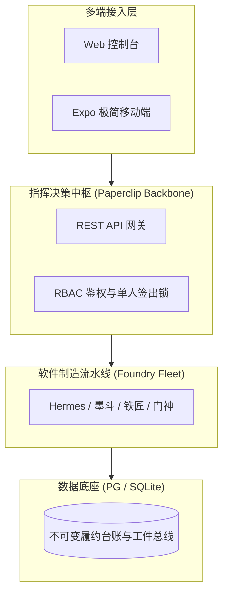

<!--
==========================================================================
【组织标准过程资产模版 (OSSP Template)】
类型: Archify 架构可视化与拓扑图 (archify)
归属: CMMI Phase 03 (03_design)
注意: 本文件为纯净空白母本，严禁直接填写项目业务数据！
      使用 node scripts/cmmi-asset-scaffold.cjs batch 派生到各项目 docs/ 中。
==========================================================================
-->

# Archify 架构拓扑模型: {{PROJECT_TITLE}}

- **更新日期**: 2026-10-17
- **归属规范**: CMMI 03_design (TS) / .agents/skills/archify

---

## 1. 架构拓扑图 (Mermaid C4 / Graph)

