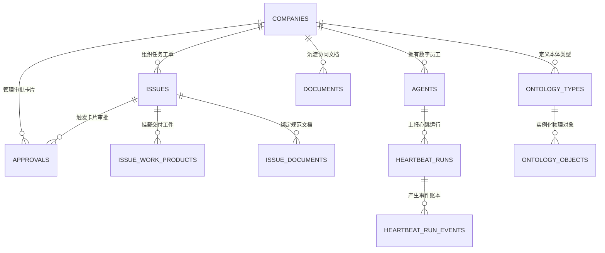

<!--
==========================================================================
【组织标准过程资产模版 (OSSP Template)】
类型: 数据库底座设计与 ERD 规范说明书
归属: CMMI Phase 03 (03_design)
注意: 本文件为纯净空白母本，严禁直接填写项目业务数据！
      使用 node scripts/cmmi-asset-scaffold.cjs batch 或 generate 派生到各项目 docs/ 中。
==========================================================================
-->

# {{PROJECT_TITLE}} · 控制面统一数据库与 ERD 设计说明书 (Drizzle ORM & PostgreSQL)

> **文档代号**: {{SYSTEM_CODE}}-DB-ERD-{{VERSION}}  
> **系统代号**: `COOLIE-FOUNDRY-CORE` ({{PROJECT_TITLE}})  
> **基线版本**: {{VERSION}} (生产冻结稳定版)  
> **制定日期**: {{DATE}}  
> **归属规范**: CMMI 03_design (TS) / ISO/IEC 9075:2016 (SQL) / .agents/skills/cmmi-detailed-contracts  

---

## 1. 数据库选型与持久化架构设计 (Persistence Architecture)

{{PROJECT_TITLE}}采用 **Drizzle ORM** 作为强类型数据映射底座，实现统一 Schema 跨双模持久化驱动：
1. **生产环境 (Production)**: 直连高可用 **PostgreSQL 17**，支撑高并发连接池与事务行级锁；
2. **本地研发与自动化单测 (Dev / Vitest)**: 自动降级至内嵌式 **WebAssembly PGlite**（`DATABASE_URL=""`），实现零外部 Docker/数据库依赖、毫秒级测试自闭环。

---

## 2. 核心领域实体关系全景图 (ERD - Entity Relationship Diagram)



---

## 3. 核心物理表结构规范 (Core Table DDL Schemas)

数据定义源码统一收拢于 [`packages/db/src/schema/`](file:///host-workspace/xaicd/coolie/packages/db/src/schema/)：

### 3.1 企业租户表 (`companies`)
```typescript
// packages/db/src/schema/companies.ts
export const companies = pgTable("companies", {
  id: uuid("id").primaryKey().defaultRandom(),
  name: varchar("name", { length: 255 }).notNull(),
  slug: varchar("slug", { length: 255 }).notNull().unique(),
  status: varchar("status", { length: 32 }).notNull().default("active"), // active | suspended | archived
  budgetLimit: integer("budget_limit").notNull().default(10000), // 分 (美分/分)
  budgetUsed: integer("budget_used").notNull().default(0),
  createdAt: timestamp("created_at").notNull().defaultNow(),
  updatedAt: timestamp("updated_at").notNull().defaultNow(),
});
```

### 3.2 任务工单与原子签出表 (`issues`)
```typescript
// packages/db/src/schema/issues.ts
export const issues = pgTable("issues", {
  id: uuid("id").primaryKey().defaultRandom(),
  companyId: uuid("company_id").notNull().references(() => companies.id),
  title: varchar("title", { length: 500 }).notNull(),
  description: text("description"),
  status: varchar("status", { length: 32 }).notNull().default("todo"), // backlog | todo | in_progress | in_review | done | cancelled
  priority: varchar("priority", { length: 16 }).notNull().default("medium"),
  assigneeAgentId: uuid("assignee_agent_id").references(() => agents.id),
  lockedBy: varchar("locked_by", { length: 128 }),
  lockedAt: timestamp("locked_at"),
  createdAt: timestamp("created_at").notNull().defaultNow(),
  updatedAt: timestamp("updated_at").notNull().defaultNow(),
});
```

### 3.3 数字员工元数据与配置表 (`agents`)
```typescript
// packages/db/src/schema/agents.ts
export const agents = pgTable("agents", {
  id: uuid("id").primaryKey().defaultRandom(),
  companyId: uuid("company_id").notNull().references(() => companies.id),
  name: varchar("name", { length: 128 }).notNull(),
  role: varchar("role", { length: 64 }).notNull(), // general | engineer | qa | lead
  status: varchar("status", { length: 32 }).notNull().default("idle"), // idle | running | paused | terminated
  budgetLimitMonthly: integer("budget_limit_monthly").notNull().default(5000),
  budgetSpentMonthly: integer("budget_spent_monthly").notNull().default(0),
  createdAt: timestamp("created_at").notNull().defaultNow(),
  updatedAt: timestamp("updated_at").notNull().defaultNow(),
});
```

### 3.4 审批卡片流表 (`approvals`)
```typescript
// packages/db/src/schema/approvals.ts
export const approvals = pgTable("approvals", {
  id: uuid("id").primaryKey().defaultRandom(),
  companyId: uuid("company_id").notNull().references(() => companies.id),
  issueId: uuid("issue_id").references(() => issues.id),
  type: varchar("type", { length: 64 }).notNull(), // hire_agent | budget_increase | code_review | release
  status: varchar("status", { length: 32 }).notNull().default("pending"), // pending | approved | rejected
  applicantId: varchar("applicant_id", { length: 128 }).notNull(),
  approverId: varchar("approver_id", { length: 128 }),
  decisionReason: text("decision_reason"),
  createdAt: timestamp("created_at").notNull().defaultNow(),
  updatedAt: timestamp("updated_at").notNull().defaultNow(),
});
```

### 3.5 不可变履约工件总线表 (`issue_work_products`)
```typescript
// packages/db/src/schema/issue_work_products.ts
export const issueWorkProducts = pgTable("issue_work_products", {
  id: uuid("id").primaryKey().defaultRandom(),
  companyId: uuid("company_id").notNull().references(() => companies.id),
  issueId: uuid("issue_id").notNull().references(() => issues.id),
  title: varchar("title", { length: 255 }).notNull(),
  kind: varchar("kind", { length: 64 }).notNull(), // git_commit | document | test_report | snapshot
  resourceRef: jsonb("resource_ref").notNull(), // { kind: "workspace_file", path: "..." }
  sha256: varchar("sha256", { length: 64 }),
  createdAt: timestamp("created_at").notNull().defaultNow(),
});
```

---

## 4. 8 大核心审计底座字段标准 (8 Audit Base Columns)

根据 CMMI 03_design (TS) 规范，所有持久化业务表严格继承 8 大审计底座字段：
`id`, `company_id`, `created_by`, `created_at`, `updated_by`, `updated_at`, `deleted_at`, `version`。
通过强类型 Drizzle ORM，在插入与更新时自动维护时间戳与版本锁，保证审计血缘不可篡改。
